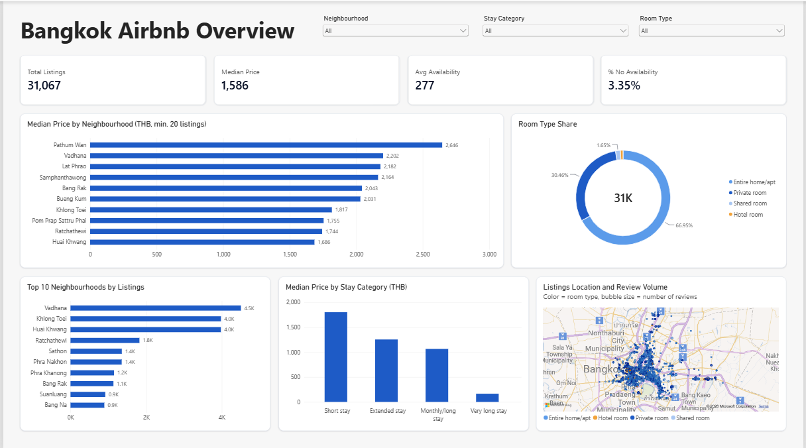

# Bangkok Airbnb Listings Analysis

End-to-end analysis of 31,067 Airbnb listings in Bangkok: cleaning and EDA in Python, business questions answered in SQL, and a Power BI dashboard.



## Business questions

1. Where are the most expensive and most affordable neighbourhoods, and how competitive is each?
2. Who supplies the market: individual hosts or professional operators?
3. Which price tiers and neighbourhoods attract the most guest activity?

## Data

- **Source:** [Inside Airbnb](https://insideairbnb.com/get-the-data/), Bangkok `listings.csv` (summary file), snapshot dated **[23/09/2026]**.
- **Size:** 31,067 listings, 7,934 hosts, 50 neighbourhoods.
- **Prices** are daily prices in local currency (THB). Data by Inside Airbnb, licensed under CC BY 4.0.

## Tools and workflow

| Step | Tool | What was done |
|---|---|---|
| Cleaning and EDA | Python (pandas) | Missing values, outlier flagging, derived columns (`price_status`, `stay_category`, `availability_status`) |
| Analysis | SQL (SQLite, DBeaver) | 25 queries across market overview, pricing, hosts, availability, reviews |
| Visualisation | Power BI | One-page overview dashboard |

## Data cleaning decisions

- 2 listings with a missing `minimum_nights` were removed, leaving 31,067 listings (from 31,069 in the raw file).
- 2,082 listings have no price, 145 are flagged as high outliers and 1 as too low. Price analysis uses only the **28,839 listings with `price_status = 'Valid'`** (92.8%).
- `reviews_per_month` is set to 0 for listings that have never been reviewed.
- Neighbourhood-level comparisons only include neighbourhoods with **at least 20 valid-price listings**, to avoid small-sample bias.

## Key insights

**1. The price premium is concentrated in the city centre.**
Average nightly price is highest in Pathum Wan (3,542 THB), Vadhana (3,323) and Bang Rak (3,087), and lowest in Thon Buri (1,245), roughly 2.8x lower than Pathum Wan. Vadhana is both expensive and the largest market (4,123 valid-price listings), so it is also the most competitive.
*Implication: central hosts can charge a premium, but must differentiate to stand out.*

**2. About half of the market belongs to professional operators.**
549 hosts with 10 or more listings (6.9% of all hosts) own 15,896 listings, which is 51.2% of the market. Overall, 43.2% of hosts manage more than one listing.
*Implication: individual hosts compete directly with operators, so quality and reviews matter more than undercutting on price.*

**3. Mid-range listings are the most active, and a third of listings have never been reviewed.**
Mid-range listings (1,000 to 5,000 THB) average 0.76 reviews per month, versus 0.71 for luxury and 0.54 for budget. 10,253 listings (33%) have no reviews at all. Lat Krabang stands out as a value neighbourhood: average price 1,803 THB (city average 2,333) with 0.97 reviews per month (city average 0.70). Khlong San is also strong (2,143 THB, 0.80 reviews per month).
*Implication: below-average price with above-average guest activity points to potential opportunities for new hosts.*

## Limitations

- Reviews are a proxy for popularity, not for actual bookings or occupancy.
- Listings without reviews count as 0 reviews per month, so part of the difference between price tiers reflects the share of never-reviewed listings.
- SQL neighbourhood rankings use **average** price, while the dashboard uses **median** price (more robust to outliers), so rankings can differ slightly.
- "No availability" on the dashboard (3.35%) means `availability_365 = 0`. This is a different measure from the "less than 30 days" metric in SQL query 04a.
- Single city, single snapshot. Findings are not a forecast.

## Repository structure

```
bangkok-airbnb-analysis/
├── data/          listings_clean.csv
├── notebook/      Python cleaning and EDA
├── sql/           analysis queries (sections 01-06)
├── dashboard/     Power BI file (.pbix) and screenshots
└── README.md
```

## How to reproduce

1. Download Bangkok `listings.csv` from Inside Airbnb.
2. Run the notebook in `notebook/` to produce `listings_clean.csv`.
3. Import `listings_clean.csv` into SQLite (e.g. via DBeaver) as table `listings_clean` and run the queries in `sql/`.
4. Open the `.pbix` file in `dashboard/` and refresh the data source path.

## Next steps

- Page 2 of the dashboard: host analysis, luxury share by neighbourhood, value neighbourhoods.
- Review text analysis (NLP) in Python.
